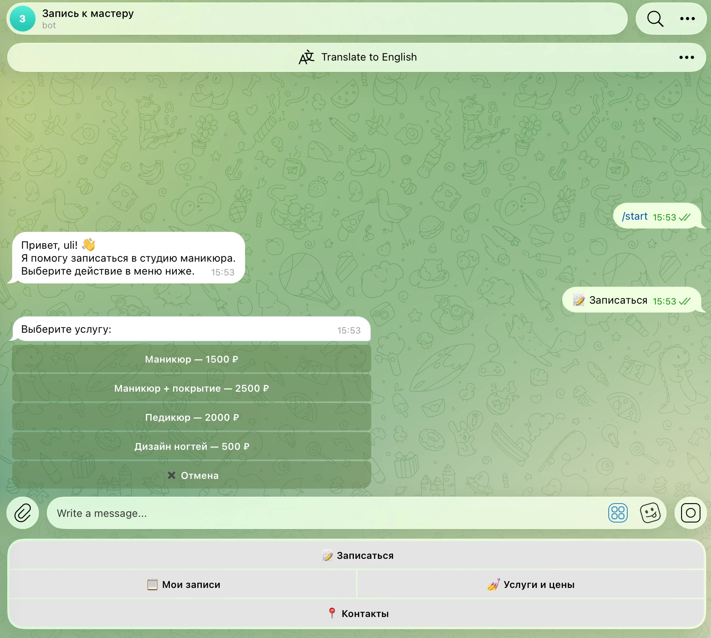
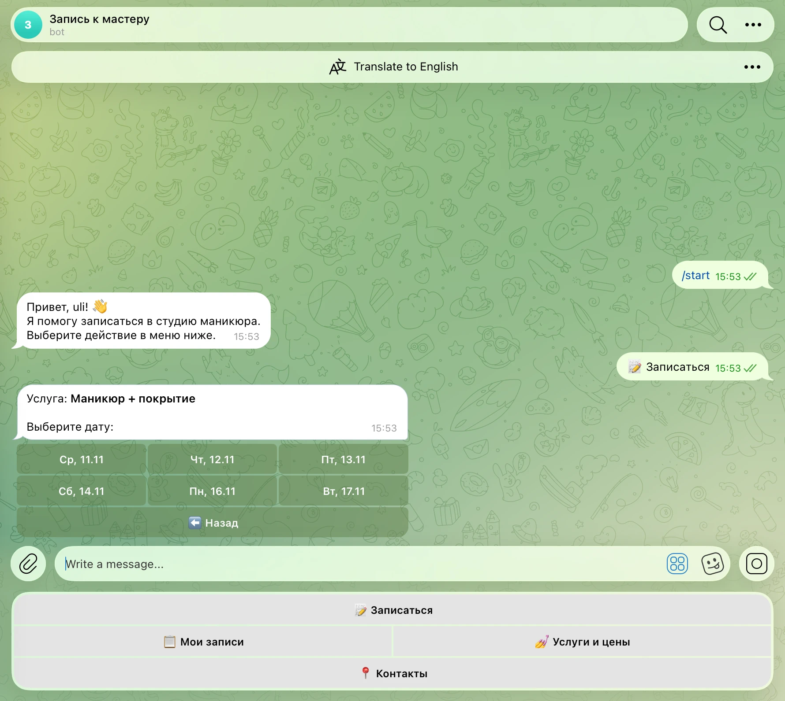
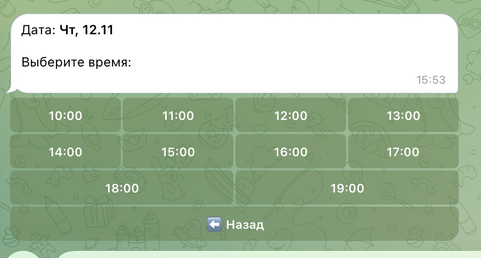
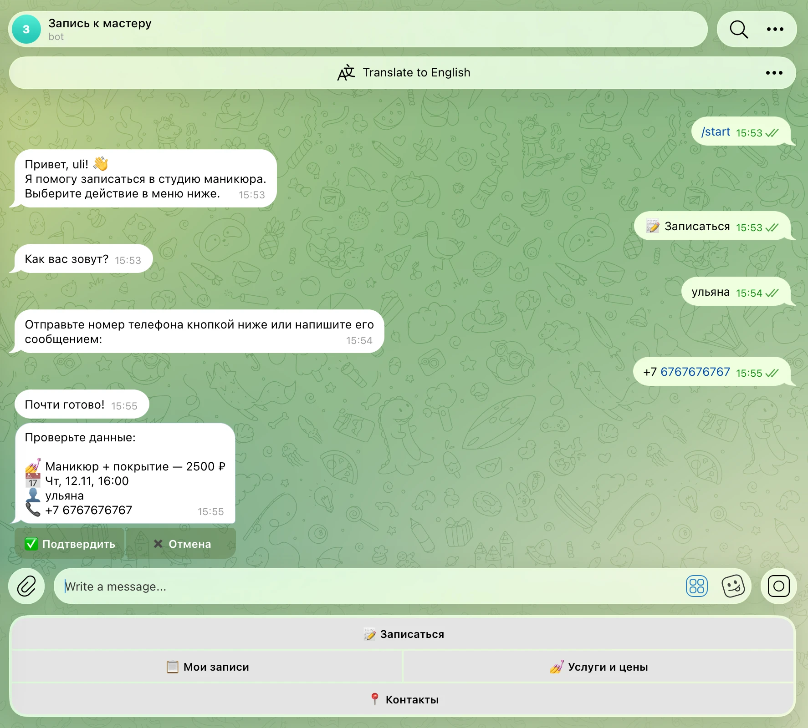
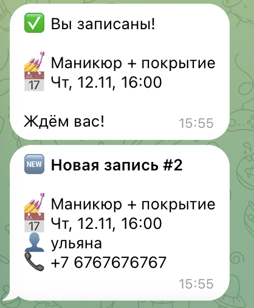
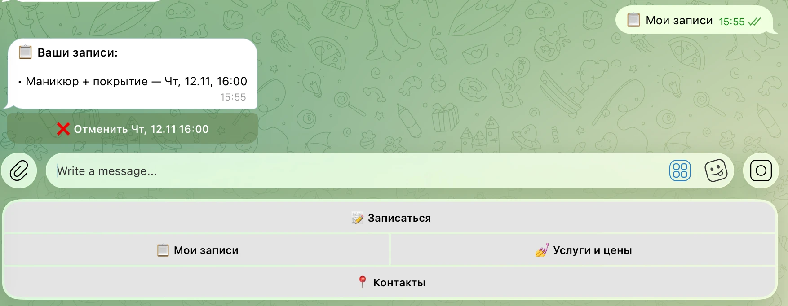
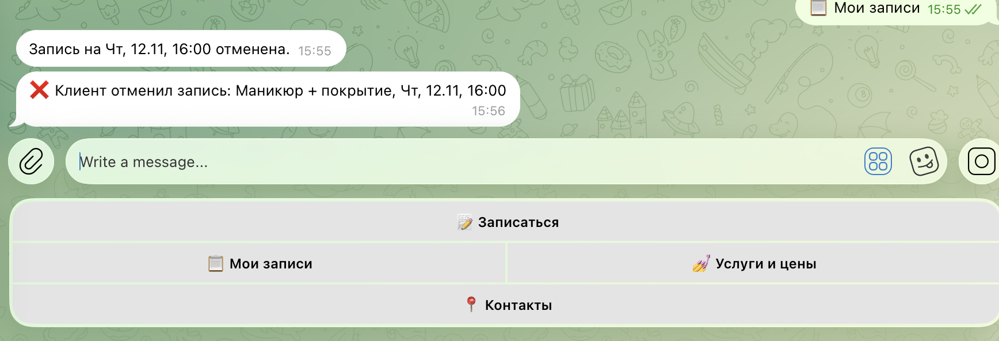

# Бот записи к мастеру

Telegram-бот для онлайн-записи клиентов в студию маникюра (легко адаптируется под барбершоп, массаж, репетитора и т.п.).

## Возможности
- Выбор услуги, даты и свободного времени через inline-кнопки
- Занятое время автоматически скрывается, двойная запись на один слот невозможна
- Отправка номера телефона одной кнопкой
- «Мои записи» — просмотр и отмена своих записей
- Уведомления мастеру о новых записях и отменах
- Команды мастера: `/today`, `/tomorrow` — расписание на день
- Услуги, цены, рабочие часы и выходные настраиваются в `config.py`

## Скриншоты

| Выбор услуги | Выбор даты | Выбор времени |
|:---:|:---:|:---:|
|  |  |  |

| Подтверждение | Запись создана + уведомление мастеру |
|:---:|:---:|
|  |  |

| Мои записи | Отмена записи |
|:---:|:---:|
|  |  |

## Стек
Python 3.11+, aiogram 3 (FSM), SQLite (aiosqlite)

## Запуск
```bash
python3 -m venv .venv
source .venv/bin/activate
pip install -r requirements.txt
cp .env.example .env   # вписать BOT_TOKEN и ADMIN_ID
python bot.py
```
